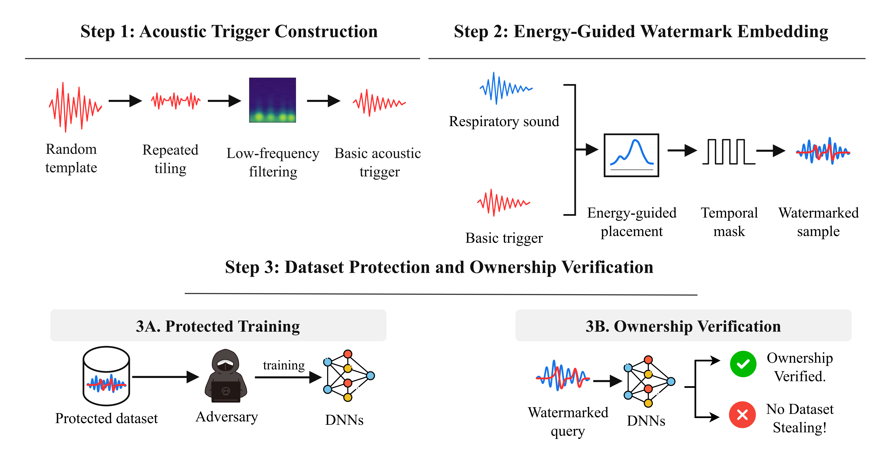

# README

This is the official implementation of our paper **"A Respiratory Sound Dataset Ownership Verification Framework via Energy-Aware Acoustic Watermarking"**. This research project is developed based on Python 3 and PyTorch.

## The Main Pipeline of Our Method



## Requirements

Install the required Python packages:

```bash
pip install torch torchvision numpy librosa soundfile tqdm pyyaml wget timm==0.4.5
```

## Usage

### Generate Benign Dataset

Our training process first extracts audio features and saves them as `.npy` files. Therefore, the first step is to perform feature extraction on the original respiratory sound training and testing sets.

```bash
python benign_feature_extract.py
```

### Train Benign Model

Train a benign respiratory sound classification model without watermarked samples.

```bash
python benign_model_train.py
```

### Generate Watermarked Dataset

Generating a watermarked dataset involves the following steps. First, embed acoustic triggers into a subset of respiratory sound files to create a protected dataset in `.wav` format. Next, extract the features of the watermarked audio and save them as `.npy` files. Finally, use the protected feature dataset to train the watermarked model.

Embed the acoustic trigger:

```bash
python trigger_embed.py
```

Extract features from the watermarked audio:

```bash
python watermarked_feature_extract.py
```

Train the watermarked model:

```bash
python watermarked_model_train.py
```

### Watermark Verification

Test the trained model using watermarked query samples and calculate the Watermark Success Rate (WSR).

```bash
python wsr_test.py
```

## Configuration

The dataset paths, GPU number, target label, model architecture, training parameters, and trigger settings can be configured in:

```text
config/config.yaml
```

The current implementation supports `resnet18`, `crnn`, and `ast` models. The respiratory sound classes used by the ICBHI dataset are `Normal`, `Crackle`, `Wheeze`, and `Both`.

